# Evidence Studio: review hub

**Training was completed. Did work change?**
Evidence Studio is a prototype decision-support tool for corporate learning and development teams, created by Dennis Griffin, Ed.D. A user ticks the training measures they actually have. A seven-link evidence chain shows how far an honest claim can reach, the user checks four workplace barriers, and the tool produces a one-page decision brief. It uses transparent, research-based rules, and it does not predict impact or calculate ROI.

This page collects everything a reviewer needs. All links on it are public.

| What | Link |
|---|---|
| **Response to the Nov 5 review (findings, fixes, matrix, rescore)** | [REVIEW_RESPONSE.md](REVIEW_RESPONSE.md) |
| Reviewer prompt (copy into ChatGPT, Argon and others) | [REVIEW_PROMPT.md](REVIEW_PROMPT.md) |
| **Hiring-panel review prompt** (seven personas; Claude, ChatGPT, Gemini, Copilot) | [PANEL_REVIEW_PROMPT.md](PANEL_REVIEW_PROMPT.md) |
| Scoring rubric | [RUBRIC.md](RUBRIC.md) |
| Narration scripts for the videos | [NARRATION_SCRIPTS.md](NARRATION_SCRIPTS.md) |
| **Product film** (about 67 s, 1080p, music, on-screen text, example inputs) | [evidence-studio-film-1080p60.mp4](https://github.com/dnnsgriffin-bit/research-space/raw/evidence-check-redesign/review/video/evidence-studio-film-1080p60.mp4) · [captions (.srt)](video/evidence-studio-film.srt) · [YouTube notes](YOUTUBE.md) · [how it is made](../tools/film/README.md) |
| Landing page walkthrough video (51 s) | [landing-v2-walkthrough.mp4](https://github.com/dnnsgriffin-bit/research-space/raw/evidence-check-redesign/screenshots/landing-v2-walkthrough.mp4) |
| Live interactive preview (needs the owner to share it) | https://claude.ai/artifact/BkRiasthCe11fzU1okZxL9 |
| Source code | [src/](../src) |

> The video links download the file in some browsers. Open the downloaded file to play it.

---

## What changed on November 12

Built after the review response below was written. None of it has been tested with practitioners yet.

| Change | Where | Why |
|---|---|---|
| **Enter your numbers.** Each ticked measure can take a result and a comparison value. The brief quotes them back neutrally (“14 points higher,” never “improved”) and states what the comparison cannot show. | `enteredResults()` in `src/lib/evidence-check.ts`; `ValueEntry` in `EvidenceCheck.tsx` | Open item 2 in the review response: the check could only say a measure existed. |
| **“These are my real numbers.”** Numbers typed after starting from an example stay labeled as illustrative until the visitor says they are their own. | `ValueEntry` in `EvidenceCheck.tsx` | Real numbers should not be exported under an “illustrative” label, and examples should not lose theirs silently. |
| **A spark from each tick to the link it lights**, and from a “No” to the link it marks. Skipped under reduced motion. | `flySpark()` in `EvidenceCheck.tsx` | On wide screens the measures and the chain sit apart; the spark ties cause to effect. |
| **Product film** replaces the earlier demo video. It is generated from the real tool, frame by frame, with on-screen lines, captions and an original synthesized soundtrack. | `tools/film/`, `review/video/`, `public/demo/` | The earlier video showed the old single-column tool and had very small captions. |
| **Three section labels removed** (“How it works,” “Pricing,” “Questions”). | `Landing.tsx` | They repeated their headings (the open question in the Impeccable evaluation). |
| **Older wording aligned** (“cheapest useful step”). | `studio-engine.ts`, `framework.tsx` | Open item 3 in the review response. |

Still open: a practitioner session, a manual screen-reader pass, a real-device motion check, and a listen to the film’s soundtrack, which was written in code and has not been reviewed by ear.

---

## 1. Landing page: first screen

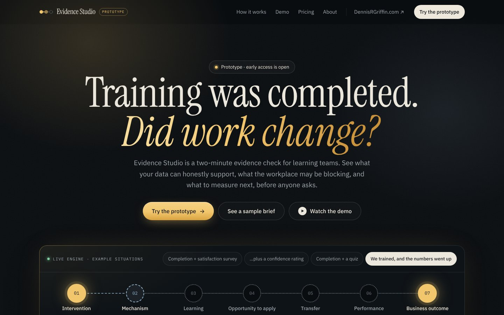

## 2. Landing page: full page, desktop

Captured with reduced motion on, so animated sections show their final state.

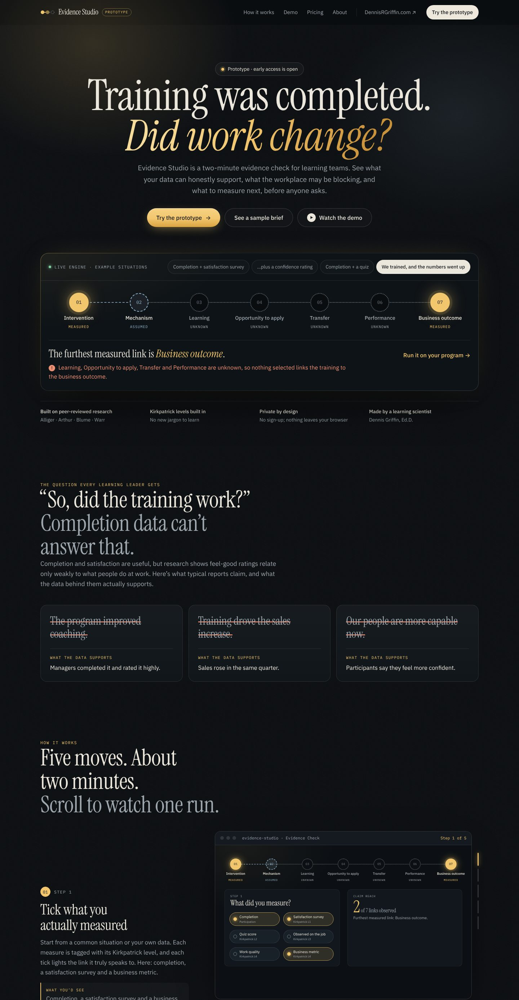
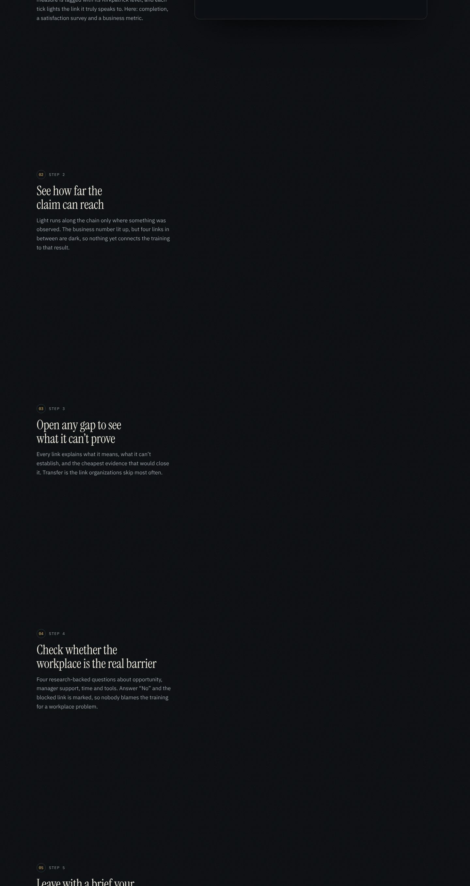
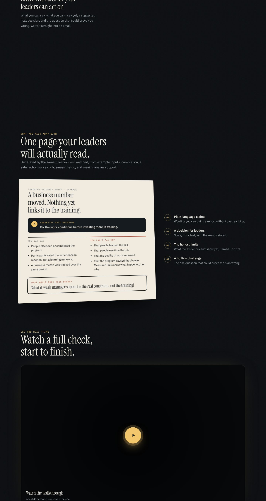
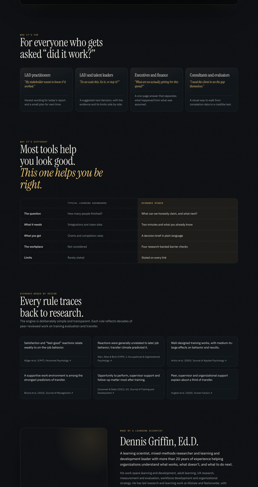
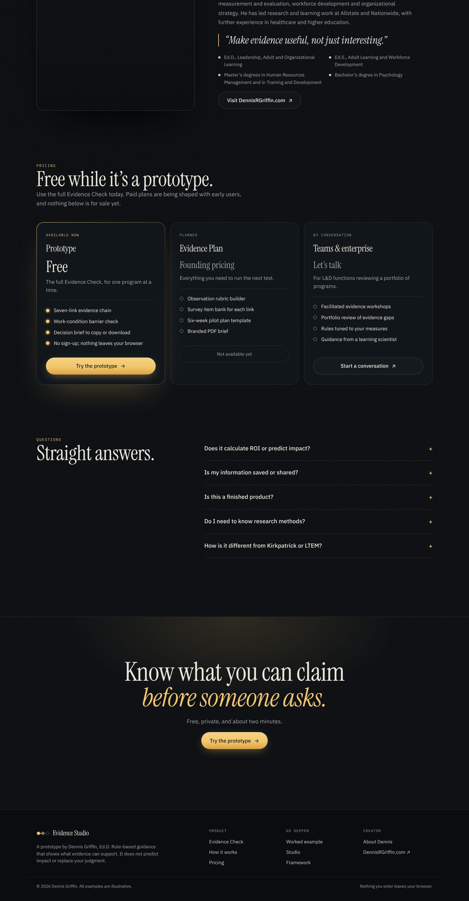

## 3. Guided scroll demo: the five steps

As visitors scroll, an animated cursor clicks through the real tool: it ticks measures, opens a gap, marks a workplace barrier, and copies the brief into an email that types itself out.

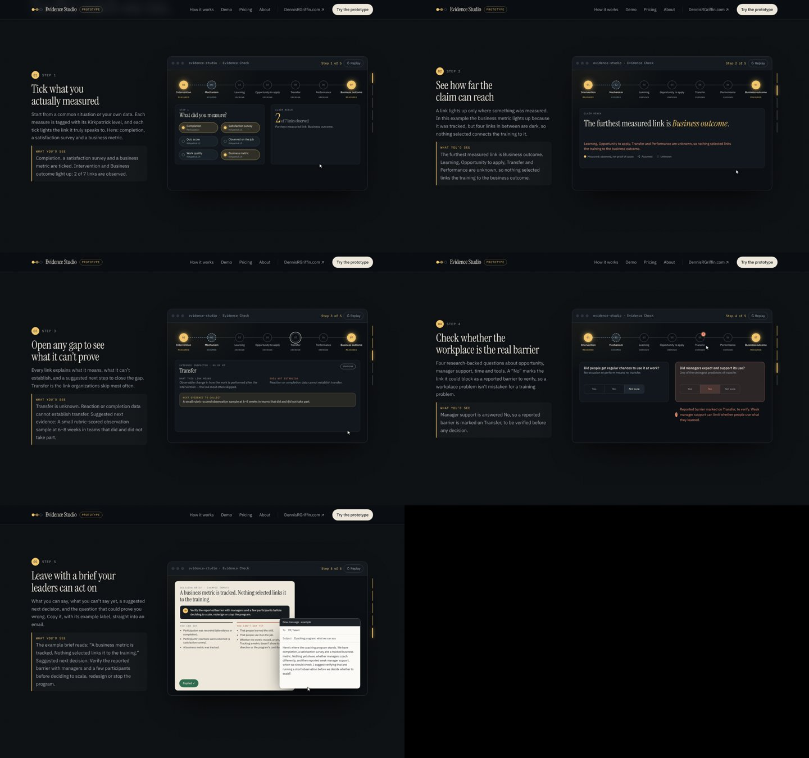

On phones, each step zooms into the part that matters, and a plain-text “What you’d see” line carries the essential result:

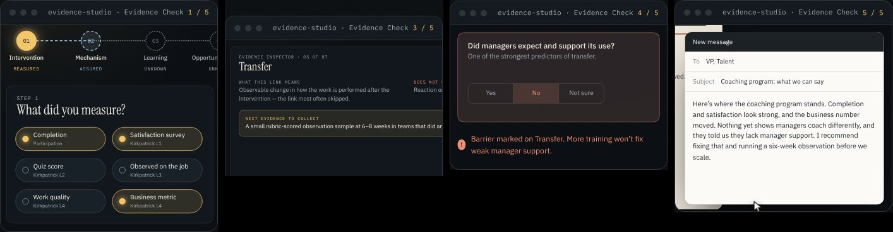

## 4. The Evidence Check tool

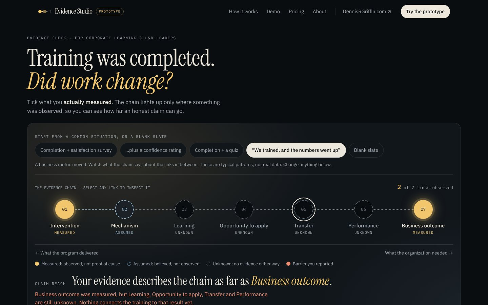
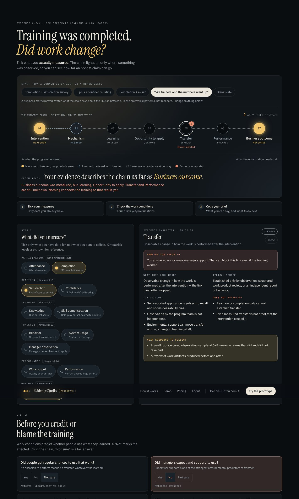
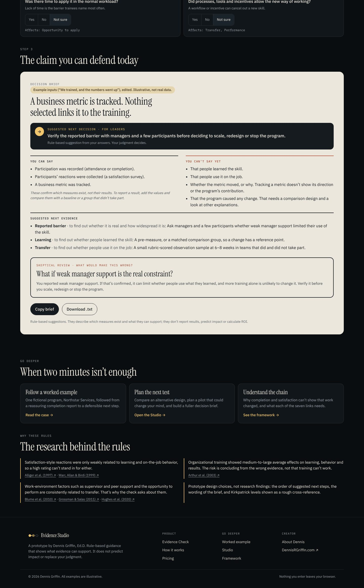

## 5. Product film: frames

The film is generated from the real tool, frame by frame, so it can be refreshed whenever the tool changes. The music is synthesized in code; it has not been reviewed by ear.

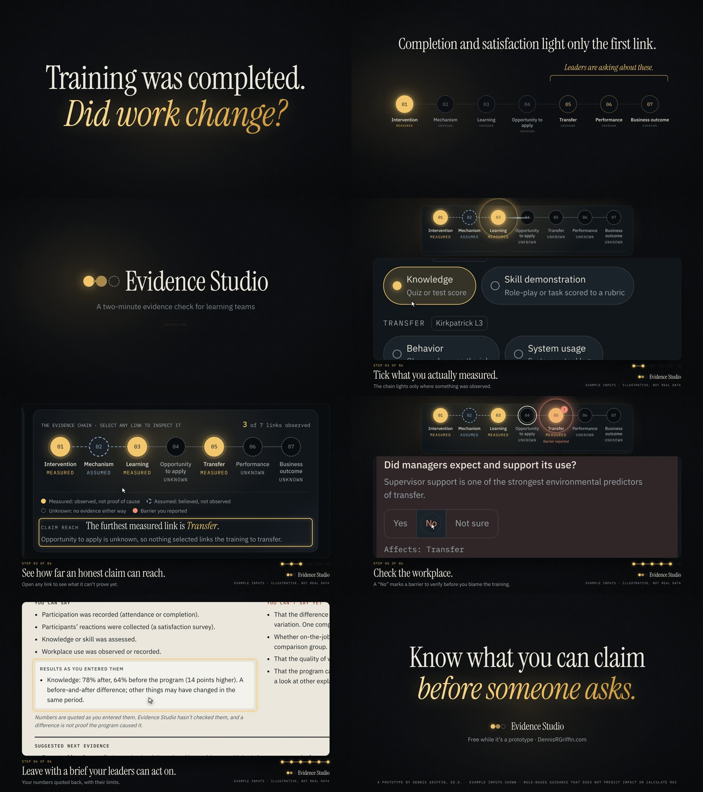

## 6. Landing page on a phone

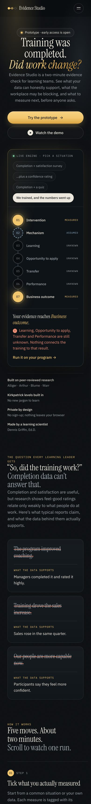
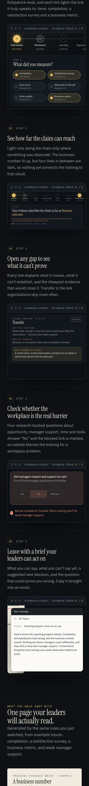
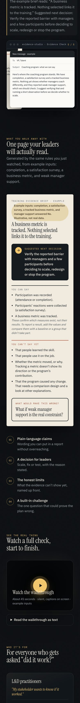
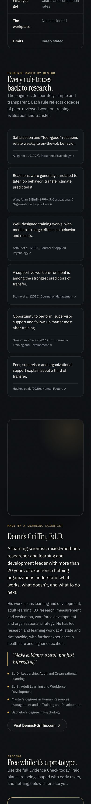
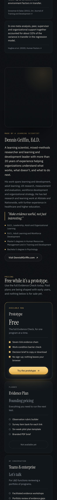
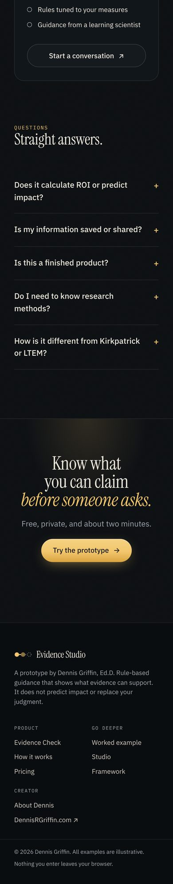
