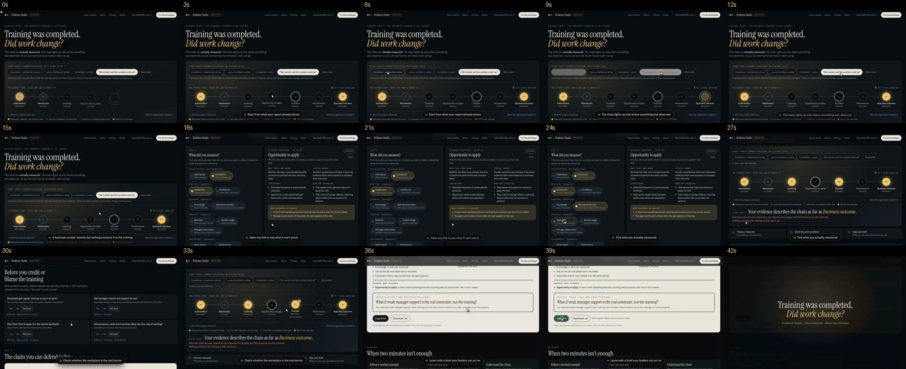

# Evidence Studio: review hub

**Training was completed. Did work change?**
Evidence Studio is a prototype decision-support tool for corporate learning and development teams, created by Dennis Griffin, Ed.D. A user ticks the training measures they actually have. A seven-link evidence chain shows how far an honest claim can reach, the user checks four workplace barriers, and the tool produces a one-page decision brief. It uses transparent, research-based rules, and it does not predict impact or calculate ROI.

This page collects everything a reviewer needs. All links on it are public.

| What | Link |
|---|---|
| **Response to the Nov 5 review (findings, fixes, matrix, rescore)** | [REVIEW_RESPONSE.md](REVIEW_RESPONSE.md) |
| Reviewer prompt (copy into ChatGPT, Argon and others) | [REVIEW_PROMPT.md](REVIEW_PROMPT.md) |
| Scoring rubric | [RUBRIC.md](RUBRIC.md) |
| Narration scripts for the videos | [NARRATION_SCRIPTS.md](NARRATION_SCRIPTS.md) |
| Product demo video (49 s, captioned, example inputs) | [evidence-check-demo.mp4](https://github.com/dnnsgriffin-bit/research-space/raw/evidence-check-redesign/public/demo/evidence-check-demo.mp4) |
| Landing page walkthrough video (51 s) | [landing-v2-walkthrough.mp4](https://github.com/dnnsgriffin-bit/research-space/raw/evidence-check-redesign/screenshots/landing-v2-walkthrough.mp4) |
| Live interactive preview (needs the owner to share it) | https://claude.ai/artifact/BkRiasthCe11fzU1okZxL9 |
| Source code | [src/](../src) |

> The video links download the file in some browsers. Open the downloaded file to play it.

---

## 1. Landing page: first screen

## 2. Landing page: full page, desktop

Captured with reduced motion on, so animated sections show their final state.

## 3. Guided scroll demo: the five steps

As visitors scroll, an animated cursor clicks through the real tool: it ticks measures, opens a gap, marks a workplace barrier, and copies the brief into an email that types itself out.

On phones, each step zooms into the part that matters, and a plain-text “What you’d see” line carries the essential result:

## 4. The Evidence Check tool

## 5. Product video: frames every 3 seconds

## 6. Landing page on a phone

